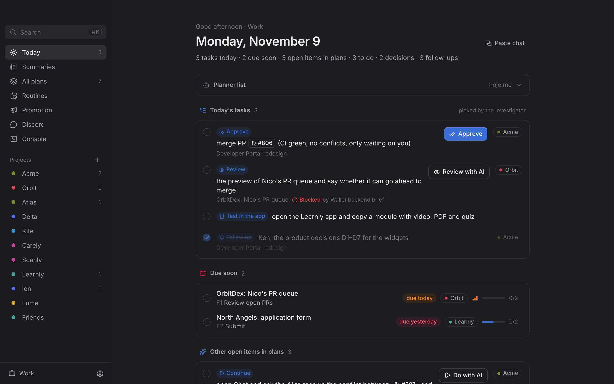
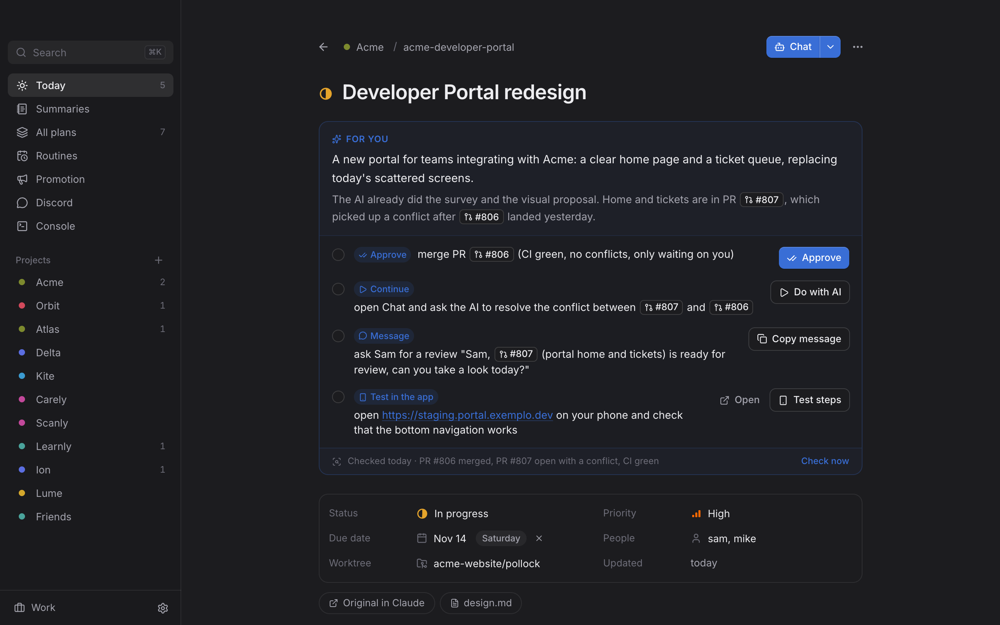
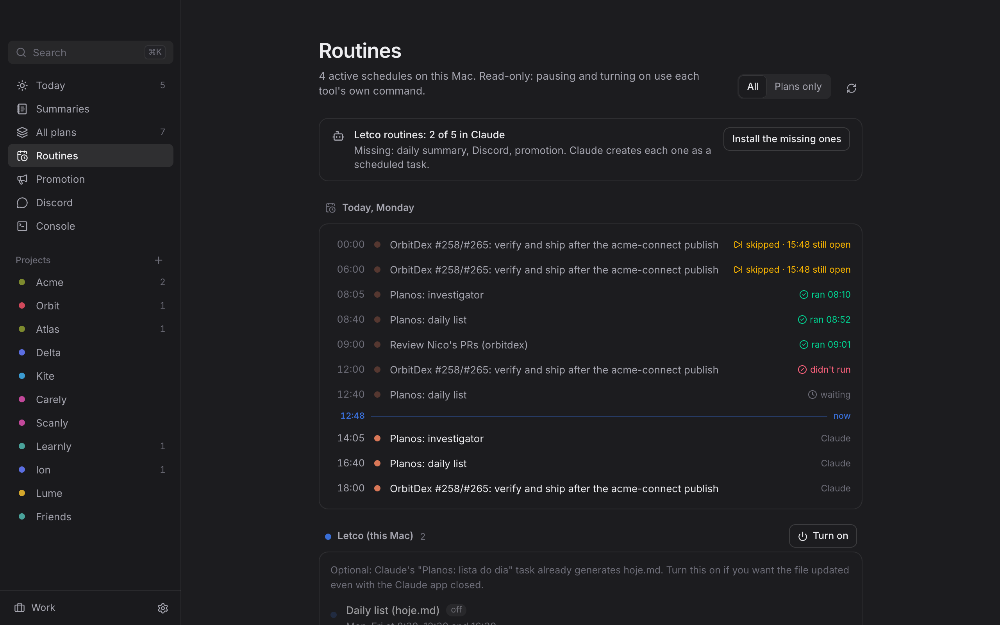
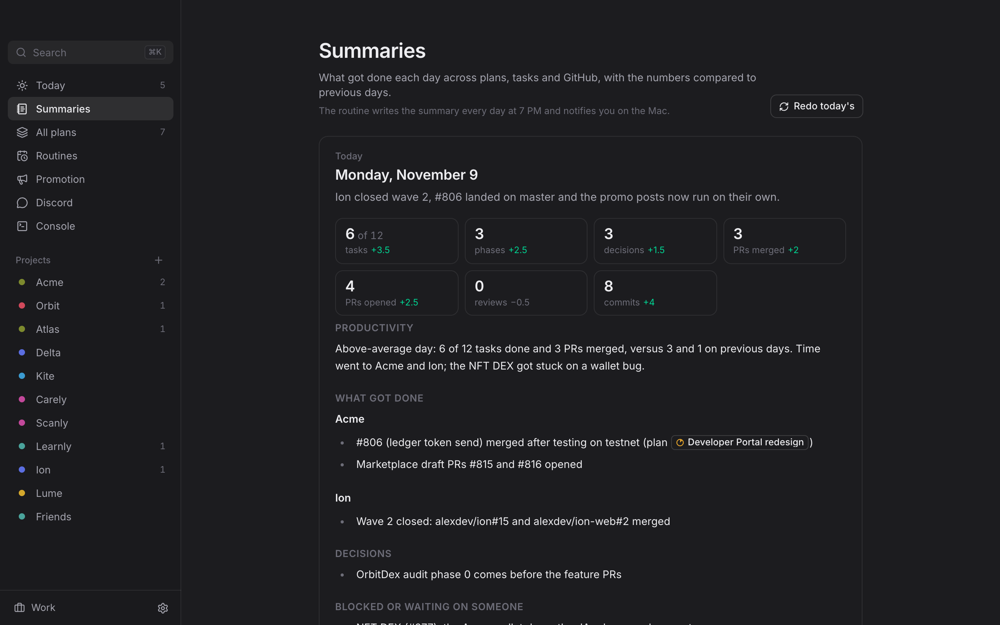
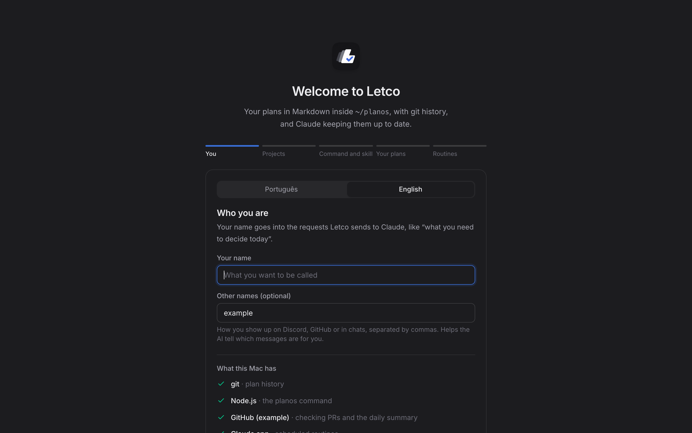

# Letco

**English** · [Português](README.pt-BR.md)

A Mac app for a personal planning system: every plan is Markdown inside `~/planos`, with git history, a daily list, and a button that opens Claude or Codex with the right context.



| | |
|---|---|
|  |  |
| **Plan**: what it's about, where it stands and what needs you | **Routines**: Claude scheduled tasks, with today's timeline |
|  |  |
| **Summaries**: what got done each day, written at 7 PM | **Setup**: from zero in five steps |

_Screenshots use the built-in sample data (invented projects and people)._

## Install

Letco is macOS-only for now. You build the app on your own Mac, so macOS opens it without asking you to allow it. It works on Apple Silicon and Intel Macs, and the first build takes about 15 minutes.

**1. Tools** (skip what you already have):

```bash
xcode-select --install
```

```bash
brew install node gh
```

```bash
corepack enable
```

```bash
curl --proto '=https' --tlsv1.2 -sSf https://sh.rustup.rs | sh
```

```bash
gh auth login
```

Without Homebrew, install Node 20 or newer from nodejs.org and the GitHub CLI from cli.github.com. Close and reopen Terminal after installing Rust.

You also need the **Claude app** (claude.ai/download), signed in to your account: the routines run there. Claude Code in the terminal (`npm install -g @anthropic-ai/claude-code`) is optional; it powers the app's Console.

**2. Build and install:**

```bash
gh repo clone llLeco/letco && cd letco
```

```bash
pnpm install && pnpm release
```

```bash
cp -R src-tauri/target/release/bundle/macos/Letco.app /Applications/ && open /Applications/Letco.app
```

**3. Setup** (the app opens it on first launch):

1. **You:** the app language (English or Portuguese), your name, and how you show up on Discord and GitHub. The app checks whether your Mac has git, Node, a signed-in `gh` and the Claude app.
2. **Projects:** your projects and working hours. This is where it creates `~/planos`, a git repository that is yours alone and never leaves your Mac unless you add a remote.
3. **Command and skill:** installs the `planos` command in `~/.local/bin` and the `planejamento` skill in Claude Code and Codex. It can also save a `.zip` of the skill to upload at claude.ai (Settings → Capabilities → Skills).
4. **Your plans:** opens a request in the Claude app to look for plans you already have scattered around (`~/.claude/plans`, `PLAN.md` and `TODO.md` in your repos, loose documents). Claude shows the list, asks which ones to bring in and only copies them; the originals stay where they are.
5. **Routines:** opens a request in the Claude app to create the scheduled tasks (investigator, daily list and daily summary; Discord and promotion are optional). On the first run of each one, Claude asks you to approve its permissions (the `planos` command, `gh`, editing `~/planos`). Approve them, or the scheduled run will sit waiting.

You can change the language anytime in **Settings → Idioma · Language**, redo everything in **Settings → Redo setup**, and see any missing routines on the **Routines** screen.

Files keep a few fixed Portuguese markers (`## Para você`, `Conferido`, `# Tarefas de…`) even in English: the app reads plans by them. On screen they appear translated.

**Update:**

```bash
git pull && pnpm install && pnpm release && cp -R src-tauri/target/release/bundle/macos/Letco.app /Applications/
```

## Claude shortcuts

The app installs three skills into `~/.claude/skills` (setup step 3, or Settings). In any Claude Code session, including the Code tab of the Claude desktop app:

- `/letco` records what the current session did in your plans: it finds the plan by repo, branch or PR, writes the Log, marks phases only with evidence and rewrites "For you". If the work has no plan and deserves one, it creates it.
- `/letco-atualizar` updates the app itself: pulls the repo, runs the checks, builds, installs into `/Applications` and reopens it.
- `planejamento` is the document format; Claude loads it on its own when you ask for a plan.

The same skills ship as a Claude Code plugin, if you'd rather install them that way:

```text
/plugin marketplace add llLeco/letco
/plugin install letco@letco
```

## Stack

- **Tauri 2** (Rust): a light native app (~10 MB), macOS vibrancy window, access to files, git and Terminal/Orca.
- **React 19 + TypeScript + Vite**.
- **Tailwind CSS 4** + **Radix UI** primitives (menus, dialogs, tooltips), **cmdk** (⌘K), **sonner** (toasts), **Lucide** icons, **Inter** font.
- Data: plain files only. `js-yaml` for the header, `react-markdown` + GFM for the body.

## What it does

- **Today**: due soon, do today (plan score: due date → blocked → project order in the current context → priority → idle time), decide, follow up, and idle for 7+ days. Complete the next phase straight from the list.
- **Automatic context** by time of day (`projetos.yaml`): Work Mon–Fri 9am–6pm, Off hours the rest. Click the sidebar footer to switch. Each project can be hidden per context (the eye next to it).
- **Documents**: everything in your projects in one list (plans, Claude designs and artifacts linked from plans, attachments, project documents, conversations), with search and filters. Drag a file onto it, or paste a link or text, and the AI reads it and files it: a new plan, an attachment to an existing plan, or a project document.
- **Promotion**: PRs merged into a campaign's branch become posts, split by category: new features and fixes each get their own post; maintenance (CI, docs, dependencies, branch merges) gets none. Each post says whether its change is only on the tracked branch (for example `develop`) or already on the production branch (`producao` in `campanhas.yaml`, `master` by default).
- **Project**: plans grouped by status, "New session" with Claude or Codex, "New plan".
- **Plan**: status, priority, due date, people, worktree; phases as a checklist (stamps the date, writes to the Log, updates the status on its own: first phase → in progress, all → in review); clickable decisions and follow-ups; Markdown editor (⌘E); archive (never deletes).
- **Chat**: opens Claude Code or Codex in the plan's worktree through Orca (`orca agent launch`) or Terminal, with a ready prompt (plan path, done and pending phases, next phase, `planejamento` skill).
- **Imports** from `~/planos/entrada/` (plans made in Claude on the web). To gather loose plans on your Mac, use "Gather my plans" (Claude searches and asks before copying).
- **planejamento skill**: installs into `~/.claude/skills/planejamento` and `~/.codex/AGENTS.md` (Settings).
- Refreshes on its own when an agent edits the files (it watches the folder). Every change becomes a commit; if there's a remote, it pushes.
- **Two languages**: screens, the `planos` command and AI replies follow `usuario.idioma` in `projetos.yaml` (English or Portuguese).

- **`planos` command** (Settings → Install, goes to `~/.local/bin`): `hoje`, `semana`, `ls`, `ver`, `falar`, `projeto`, `novo`, `status`, `prazo`, `prioridade`, `fase concluir|reabrir|nova`, `editar`, `arquivar`, `importar`, `iniciar --nome X`, `agendar`, `rotinas`, `rotina <id>`. `planos hoje --escrever` writes `hoje.md`; `planos agendar` turns on the weekday jobs (8:30, 12:30, 16:30 and Friday 17:00) in launchd. Command names stay in Portuguese in both languages.

Shortcuts: ⌘K search · ⌘N new plan · ⌘1 Today · ⌘2 All plans · ⌘E edit Markdown · ⌘, Settings · Esc back.

## Development

```bash
pnpm install
pnpm tauri dev        # native app with reload
pnpm dev              # interface only, in the browser, with sample data (add ?novo to the URL to try the first-run setup)
pnpm cli              # bundles the planos command into dist-cli/planos.mjs
pnpm release          # command + Letco.app + .dmg in src-tauri/target/release/bundle/
pnpm check            # types, lint and tests (what CI runs on every PR)
```

`PLANOS_DIR=/another/folder` changes the root (handy for testing without touching `~/planos`).

## Structure

```
src/lib/plan.ts      reads and writes plano.md (header, phases, decisions, follow-ups, log)
src/lib/score.ts     scoring and the daily list
src/lib/config.ts    projetos.yaml, contexts and order
src/lib/migrate.ts   import from entrada/
src/lib/prompt.ts    requests to the AI (Chat, investigator, gather plans, console)
src/lib/rotinas.ts   the Letco routines (the text `planos rotina <id>` prints)
src/lib/usuario.ts   who uses the app (`usuario` in projetos.yaml), for the AI requests
src/lib/i18n.ts      app language: t('pt', 'en'), dates, and the language rule for AI requests
src/components/Onboarding.tsx  first run: profile, projects, command and skill, plans, routines
src/lib/digest.ts    hoje.md and semana.md
cli/planos.ts        the terminal command (shares the app's libs)
src-tauri/src/lib.rs backend: files, git, watcher, Orca/Terminal, skill
plugin/skills/       the skills the app installs (also a Claude Code plugin): planejamento, letco and letco-atualizar
```

## License

[MIT](LICENSE)
