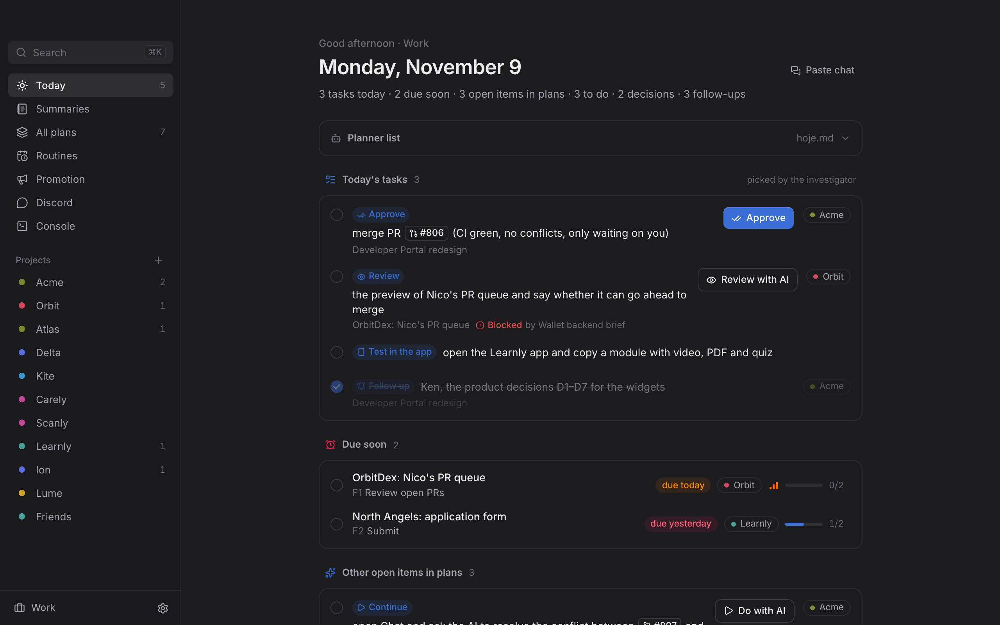
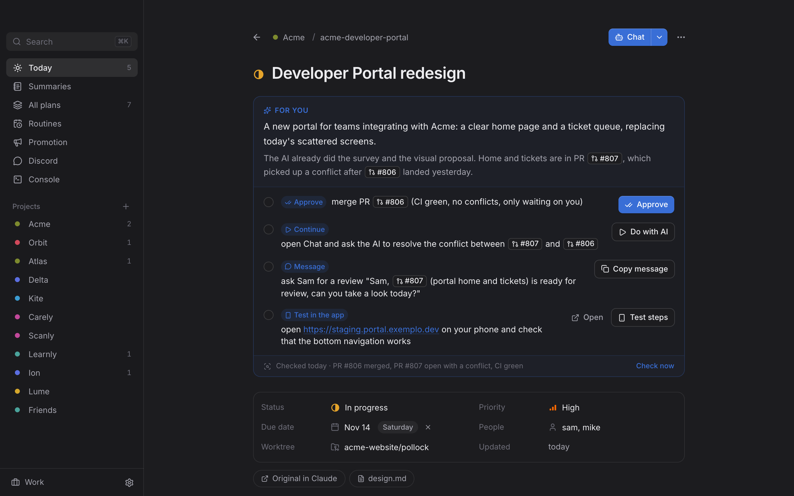
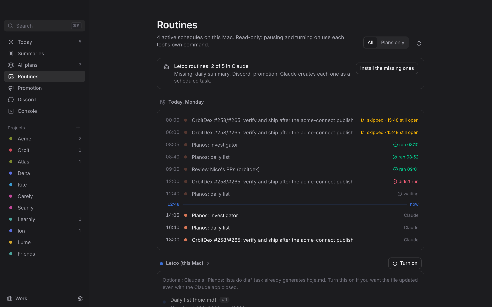
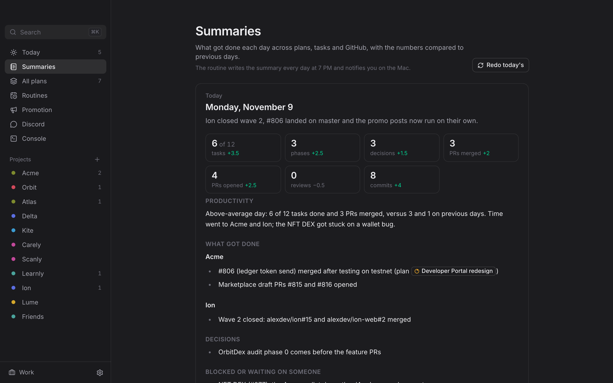
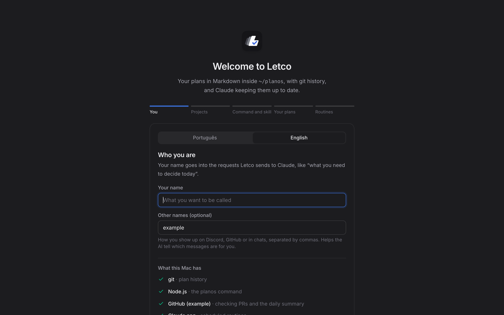

# Letco

[English](README.md) · **Português**

App de Mac para o sistema próprio de planejamentos: todos os planos em Markdown dentro de `~/planos`, com histórico no git, uma lista do dia e um botão para abrir Claude ou Codex com o contexto certo.



| | |
|---|---|
|  |  |
| **Plano**: do que se trata, como está e o que depende de você | **Rotinas**: tarefas agendadas do Claude, com a linha do tempo do dia |
|  |  |
| **Resumos**: o que foi feito em cada dia, escrito às 19h | **Configuração**: do zero em cinco passos |

_As imagens usam os dados de exemplo do app (projetos e pessoas inventados) e estão em inglês._

## Instalar

O app é compilado na sua máquina: assim o macOS abre sem pedir liberação. Precisa de um Mac com Apple Silicon ou Intel e de uns 15 minutos na primeira vez.

**1. Ferramentas** (pule o que já tiver):

```bash
xcode-select --install
```

```bash
brew install node gh
```

```bash
corepack enable
```

```bash
curl --proto '=https' --tlsv1.2 -sSf https://sh.rustup.rs | sh
```

```bash
gh auth login
```

Sem Homebrew, instale o Node 20 ou mais novo pelo nodejs.org e o GitHub CLI pelo cli.github.com. Feche e abra o Terminal depois do Rust.

Também precisa do **app do Claude** (claude.ai/download) logado na sua conta: é nele que as rotinas rodam. O Claude Code no terminal (`npm install -g @anthropic-ai/claude-code`) é opcional, para o Console do app.

**2. Compilar e instalar:**

```bash
gh repo clone llLeco/letco && cd letco
```

```bash
pnpm install && pnpm release
```

```bash
cp -R src-tauri/target/release/bundle/macos/Letco.app /Applications/ && open /Applications/Letco.app
```

**3. Onboarding** (o app abre nele na primeira vez):

1. **Você:** o idioma do app (português ou inglês), seu nome e como você aparece no Discord e no GitHub. O app confere se o Mac tem git, Node, `gh` logado e o app do Claude.
2. **Projetos:** os projetos e o horário de trabalho. Aqui ele cria `~/planos`, um repositório git só seu, que nunca sai do Mac a menos que você configure um remoto.
3. **Comando e skill:** instala o comando `planos` em `~/.local/bin` e a skill `planejamento` no Claude Code e no Codex. Também salva um `.zip` da skill para enviar no claude.ai (Ajustes → Capabilities → Skills).
4. **Seus planos:** abre um pedido no app do Claude para procurar os planos que você já tem espalhados (`~/.claude/plans`, `PLAN.md` e `TODO.md` nos repositórios, documentos soltos). Ele mostra a lista, pergunta quais entram e só copia; os originais ficam onde estão.
5. **Rotinas:** abre um pedido no app do Claude para criar as tarefas agendadas (investigador, lista do dia e resumo do dia; Discord e divulgação são opcionais). Na primeira rodada de cada uma, o Claude pede para você aprovar as permissões (comando `planos`, `gh`, edição em `~/planos`): aprove, senão a rodada agendada fica parada esperando.

O idioma pode ser trocado a qualquer hora em **Ajustes → Idioma · Language**. Tudo isso pode ser refeito depois em **Ajustes → Refazer configuração**, e as rotinas que faltam aparecem na tela **Rotinas**.

**Atualizar:**

```bash
git pull && pnpm install && pnpm release && cp -R src-tauri/target/release/bundle/macos/Letco.app /Applications/
```

## Stack

- **Tauri 2** (Rust): app nativo leve (~10 MB), janela com vibrancy do macOS, acesso a arquivos, git e Terminal/Orca.
- **React 19 + TypeScript + Vite**.
- **Tailwind CSS 4** + primitivos **Radix UI** (menus, diálogos, tooltips), **cmdk** (⌘K), **sonner** (avisos), ícones **Lucide**, fonte **Inter**.
- Dados: só arquivos. `js-yaml` para o cabeçalho, `react-markdown` + GFM para o corpo.

## O que faz

- **Hoje**: prazo vencendo, fazer hoje (pontuação do plano: prazo → bloqueio → ordem do projeto no contexto → prioridade → tempo parado), decidir, cobrar e parados há 7+ dias. Concluir a próxima fase direto da lista.
- **Contexto automático** pelo horário (`projetos.yaml`): Trabalho seg–sex 9h–18h, Fora do horário no resto. Clique no rodapé da barra lateral para alternar.
- **Projeto**: planos agrupados por status, "Nova sessão" com Claude ou Codex, "Novo plano".
- **Plano**: status, prioridade, prazo, pessoas, worktree; fases com checklist (marca a data, escreve no Log, muda status sozinho: primeira fase → andamento, todas → revisão); decisões e cobranças clicáveis; editor do Markdown (⌘E); arquivar (nunca apaga).
- **Conversar**: abre Claude Code ou Codex no worktree do plano pelo Orca (`orca agent launch`) ou no Terminal, com prompt pronto (caminho do plano, fases feitas e pendentes, próxima fase, skill `planejamento`).
- **Importa** de `~/planos/entrada/` (planos feitos no Claude da web) e, se existir, de `~/.hermes/planos`. Para juntar planos soltos no Mac, use "Juntar meus planos" (o Claude procura e pergunta antes de copiar).
- **Skill planejamento**: instala em `~/.claude/skills/planejamento` e no `~/.codex/AGENTS.md` (Ajustes).
- Atualiza sozinho quando um agente mexe nos arquivos (observa a pasta). Cada mudança vira commit; se houver remoto, envia.

- **Comando `planos`** (Ajustes → Instalar, vai para `~/.local/bin`): `hoje`, `semana`, `ls`, `ver`, `falar`, `projeto`, `novo`, `status`, `prazo`, `prioridade`, `fase concluir|reabrir|nova`, `editar`, `arquivar`, `importar`, `iniciar --nome X`, `agendar`, `rotinas`, `rotina <id>`. `planos hoje --escrever` grava o `hoje.md` no formato do doc; `planos agendar` liga as rotinas de dias úteis (8h30, 12h30, 16h30 e sexta 17h) no launchd.

Atalhos: ⌘K busca · ⌘N novo plano · ⌘1 Hoje · ⌘2 Todos · ⌘E editar Markdown · ⌘, Ajustes · Esc volta.

## Desenvolvimento

```bash
pnpm install
pnpm tauri dev        # app nativo com recarga
pnpm dev              # só a interface no navegador, com dados de exemplo
pnpm cli              # empacota o comando planos em dist-cli/planos.mjs
pnpm release          # comando + Letco.app + .dmg em src-tauri/target/release/bundle/
pnpm check            # tipos, lint e testes (o que o CI roda em cada PR)
```

`PLANOS_DIR=/outra/pasta` troca a raiz (útil para testar sem mexer em `~/planos`).

## Estrutura

```
src/lib/plan.ts      leitura e escrita do plano.md (cabeçalho, fases, decisões, cobranças, log)
src/lib/score.ts     pontuação e lista do dia
src/lib/config.ts    projetos.yaml, contextos e ordem
src/lib/migrate.ts   importação do Hermes e de entrada/
src/lib/prompt.ts    pedidos à IA (Conversar, investigador, juntar planos, console)
src/lib/rotinas.ts   as rotinas do Letco (texto que `planos rotina <id>` imprime)
src/lib/usuario.ts   quem usa o app (`usuario` no projetos.yaml), para os pedidos à IA
src/lib/i18n.ts      idioma do app: t('pt', 'en'), datas e a regra de idioma dos pedidos à IA
src/components/Onboarding.tsx  primeira vez: perfil, projetos, comando e skill, planos, rotinas
src/lib/digest.ts    hoje.md e semana.md
cli/planos.ts        o comando de terminal (usa as mesmas libs do app)
src-tauri/src/lib.rs backend: arquivos, git, watcher, Orca/Terminal, skill
skill/planejamento   a skill global do padrão de documentos
```

## Licença

[MIT](LICENSE)
